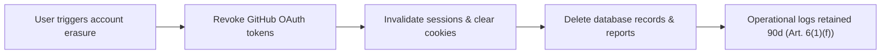

# Legal, Privacy & Compliance

Milestone 3 established RepoPrint's comprehensive legal, privacy, and regulatory framework. This document details the compliance posture across data protection (GDPR), artificial intelligence transparency (EU AI Act), sector-specific cybersecurity regulations, software licensing, and platform terms of service.

---

## 1. GDPR & Privacy Architecture

RepoPrint is designed around **Privacy by Design and by Default** (Article 25 of Regulation (EU) 2016/679 — GDPR).

### 1.1. Personal Data Collected

| Category | Data Elements | Purpose & Lawful Basis |
| :--- | :--- | :--- |
| **Authentication & Accounts** | Full name, email address, GitHub username, OAuth 2.0 access tokens, IP address, session cookies (Keycloak). | **Consent** (Art. 6(1)(a)) & **Contract Performance** (Art. 6(1)(b)). |
| **Code Committers** | Author name, author email, commit timestamp extracted from Git history. | **Legitimate Interest** (Art. 6(1)(f)) in assessing architectural and team hygiene. |
| **Operational & Audit Logs** | IP address, user identifiers, API request timestamps, scan parameters. | **Legitimate Interest** (Art. 6(1)(f)) for fraud prevention, network security, and ISO/IEC 27001 auditability. |

### 1.2. Pseudonymization & Anonymization

- **Contributor Pseudonymization:** Author names and email addresses extracted from Git metadata are automatically replaced with consistent pseudonyms during analysis, preserving commit topology without directly exposing personal identities in shareable reports.
- **Aggregated Statistics:** Team dynamics (commit cadence, review ratios, merge latency) are computed at the repository level without maintaining individual contributor linkages.
- **Log Scrubbing:** Operational logs retain IP addresses and user IDs for a maximum of **90 days**. Upon expiry, identifiers are permanently deleted or irreversibly anonymized.

### 1.3. Right to Be Forgotten (Data Erasure Procedure)

Users can initiate complete account and data erasure directly through the application settings:

1. **OAuth Revocation:** Active GitHub OAuth access tokens are revoked via the GitHub API.
2. **Session Termination:** All active Keycloak sessions and cookies are invalidated immediately.
3. **Database Scrubbing:** User account profiles, associated repository configurations, and historical analysis reports are wiped from PostgreSQL within **48 hours**.
4. **Audit Log Exemption:** Technical operational logs are maintained up to the standard 90-day threshold under GDPR Art. 6(1)(f) (Legitimate Interest) exclusively for infrastructure defense and cybersecurity incident response.

### 1.4. Technical Security Controls (Art. 32 GDPR)

- **Encryption in Transit:** Strict HTTPS/TLS termination enforced by a Docker reverse proxy.
- **Encryption at Rest:** Sensitive tokens and credentials encrypted in PostgreSQL using **AES-256** via `pgcrypto`. Docker persistent storage volumes reside on encrypted virtual machine partitions.
- **Ephemeral Code Processing:** Cloned repository source trees exist only in isolated temporary containers and are **permanently purged immediately upon scan completion or failure**.
- **Role-Based Access Control:** Centralized identity management and role authorization via **Keycloak**.
- **Local AI Privacy:** The Small Language Model (SLM) runs locally via Ollama. Repository code, threat findings, and prompts are **never transmitted to external cloud AI providers**.

---

## 2. Sector-Specific Regulations

| Regulation | Applicability to RepoPrint | Justification & Compliance Posture |
| :--- | :--- | :--- |
| **EU AI Act (Regulation (EU) 2024/1689)** | **Article 50 Transparency applies** | The AI assistant only generates security recommendations and powers conversational advice, qualifying as a limited-risk system. All outputs are explicitly marked as AI-generated with human-review disclaimers. The AI is strictly barred from evaluating or rating individual developer performance. |
| **Portuguese Cybercrime Law (Lei n.º 109/2009)** | **Directly relevant to operations** | Prohibits illegitimate access to computer systems. RepoPrint strictly analyses public repositories or private repositories explicitly authorized through user OAuth tokens. Analysis is purely static and non-exploitative. |
| **ISO/IEC 27001 & ISO 20000 / ITIL** | **Voluntary standards** | RepoPrint maps detected threats to ISO/IEC 27001 Annex A controls in its audit reports. Internal development follows formal PR review gates, branch protection, and automated CI/CD change management. |
| **NIS 2 Directive (DL 125/2025, CNCS)** | **Not directly applicable (User-facing feature)** | RepoPrint is a non-commercial student project without commercial turnover. However, audit findings are mapped against NIS 2 Art. 21 cybersecurity measures so enterprise users can leverage the reports as compliance evidence. |
| **Cyber Resilience Act (CRA)** | **Exempt under open-source research** | Free open-source software developed outside a commercial activity is out of scope. RepoPrint maintains a software bill of materials (SBOM) and dependency inventory to remain prepared for future commercialization. |

---

## 3. Software Licensing & Dependency Audit

A comprehensive dependency inventory was conducted across 283 third-party packages to guarantee license compatibility and prevent copyleft contamination:

### 3.1. License Breakdown

| License | Backend | Frontend | Other | Total | Classification |
| :--- | :---: | :---: | :---: | :---: | :--- |
| **MIT** | 11 | 182 | 3 | **196** | Permissive |
| **ISC** | 0 | 23 | 0 | **23** | Permissive |
| **Apache-2.0** | 1 | 19 | 3 | **23** | Permissive (patent grant) |
| **BSD-2-Clause** | 0 | 19 | 0 | **19** | Permissive |
| **BSD-3-Clause** | 6 | 5 | 0 | **11** | Permissive |
| **MPL-2.0** | 1 | 2 | 0 | **3** | Weak Copyleft (file-level) |
| **PSF-2.0 / Python-2.0** | 1 | 1 | 1 | **3** | Permissive |
| **0BSD / PostgreSQL / CC-BY-4.0** | 0 | 2 | 2 | **4** | Permissive / Attribution |
| **LGPL-3.0 or Later** | 0 | 1 | 0 | **1** | Weak Copyleft |
| **Total** | **19** | **254** | **10** | **283** | **Fully Audited** |

### 3.2. Critical Compliance Guardrails

- **LGPL-3.0 Compliance:** Any library licensed under LGPL-3.0 must remain dynamically linked and replaceable by the end-user, ensuring copyleft provisions do not extend to the surrounding proprietary code.
- **MPL-2.0 Compliance:** Packages under Mozilla Public License 2.0 must be utilized unmodified. Any modifications to MPL-covered source files must be made available under the same license.

---

## 4. Terms and Conditions Summary

RepoPrint's legal terms define clear operating contracts between the platform and its users:

- **Dual Operational Modes:**
  - *Anonymous Mode:* Public repositories only; zero data persistence; immediate source and finding disposal.
  - *Authenticated Mode:* GitHub OAuth; encrypted credentials; private repository scanning; persistent report history.
- **Permitted & Prohibited Use:** Strict prohibition against utilizing RepoPrint for unauthorized reconnaissance, vulnerability exploitation, or automated denial-of-service scanning against GitHub infrastructure.
- **Intellectual Property:** Users retain **100% intellectual property ownership** of their submitted source code and repositories. RepoPrint claims no ownership rights over analyzed projects.
- **Disclaimers & Liability Limits:** Service is provided "as is". Findings represent automated heuristic estimations and do not constitute legal compliance certifications or replace human security audits.
- **Governing Law & Jurisdiction:** Governed by Portuguese law, with exclusive legal venue established in the Judicial District of Aveiro (*Tribunal da Comarca de Aveiro*).
